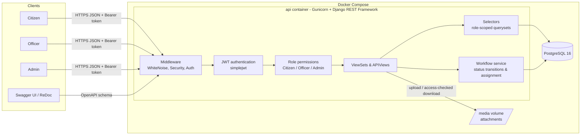
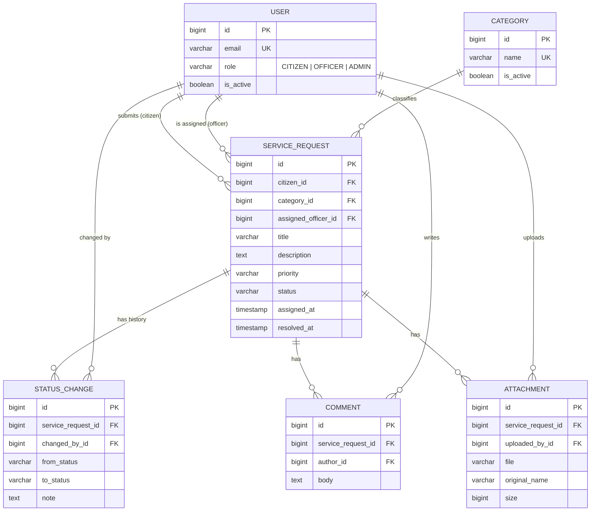
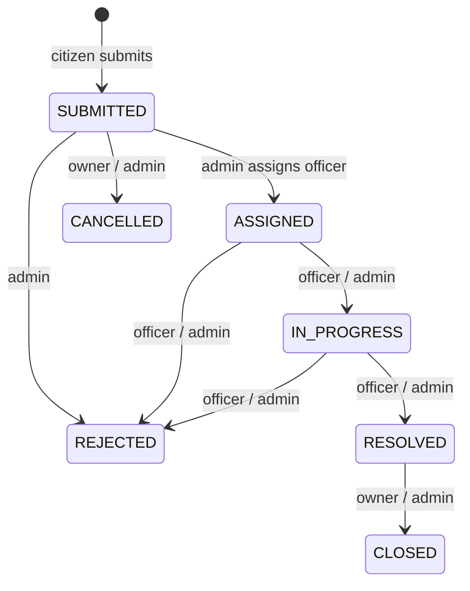

# Government Service Request Management System

A REST API backend where **citizens** submit service requests, **officers** process them, and
**admins** manage categories, users, assignments and statistics.

Built with Python 3.12, Django 5.2, Django REST Framework, PostgreSQL 16, JWT auth, Docker and pytest.

---

## Contents

- [Features](#features)
- [Architecture](#architecture)
- [Entity Relationship Diagram](#entity-relationship-diagram)
- [Quick start (Docker)](#quick-start-docker)
- [Configuration](#configuration)
- [API documentation](#api-documentation)
- [Endpoints](#endpoints)
- [Roles and permissions](#roles-and-permissions)
- [Request status workflow](#request-status-workflow)
- [Running tests](#running-tests)
- [Project structure](#project-structure)
- [Git workflow](#git-workflow)
- [Design decisions](#design-decisions)

---

## Features

**Authentication**
- Register (always creates a Citizen), JWT login / refresh / logout (refresh-token blacklisting)
- Roles: `CITIZEN`, `OFFICER`, `ADMIN`; role embedded as a JWT claim

**Service requests**
- Create / view / update requests with category, title, description and priority
- Strict status workflow with per-role transitions and full status history
- Officer assignment and reassignment
- Comments and file attachments (validated type & size, access-checked downloads)
- Filtering, search, ordering and pagination on the list endpoint

**Admin**
- Manage categories, create officers/admins, change roles, deactivate users
- Assign officers, view all requests
- Statistics: counts by status / priority / category, officer workload, average resolution time

---

## Architecture



More diagrams (request lifecycle sequence, state machine, code layout): [docs/architecture.md](docs/architecture.md).

---

## Entity Relationship Diagram



Full column list and notes: [docs/erd.md](docs/erd.md).

---

## Quick start (Docker)

Requirements: Docker with Docker Compose v2.

```bash
git clone <repo-url> service-management-system
cd service-management-system
cp .env.example .env            # adjust secrets if needed
docker compose up -d --build    # migrations run automatically on start
docker compose exec api python manage.py seed_demo   # optional demo data
```

The API is now at <http://localhost:8000/api/v1/> and the docs at <http://localhost:8000/api/docs/>.

### Demo accounts (created by `seed_demo`)

| Role | Email | Password |
|---|---|---|
| Admin | `admin@gsr.local` | `DemoPass123!` |
| Officer | `officer@gsr.local` | `DemoPass123!` |
| Citizen | `citizen@gsr.local` | `DemoPass123!` |

`seed_demo` also creates five categories. It is idempotent; pass `--password` to choose another password.
To create your own first admin instead: `docker compose exec api python manage.py createsuperuser`
(superusers always get the `ADMIN` role).

### Try it with curl

```bash
# log in as the citizen and keep the access token
TOKEN=$(curl -s -X POST localhost:8000/api/v1/auth/login/ \
  -H 'Content-Type: application/json' \
  -d '{"email":"citizen@gsr.local","password":"DemoPass123!"}' | jq -r .access)

# submit a request
curl -X POST localhost:8000/api/v1/requests/ \
  -H "Authorization: Bearer $TOKEN" -H 'Content-Type: application/json' \
  -d '{"category":1,"title":"Leaking pipe","description":"Main pipe on Road 5","priority":"HIGH"}'
```

---

## Configuration

All settings come from environment variables (see [.env.example](.env.example)).

| Variable | Default | Description |
|---|---|---|
| `DJANGO_SECRET_KEY` | — (required) | Django secret key, also signs JWTs |
| `DJANGO_DEBUG` | `0` | Debug mode |
| `DJANGO_ALLOWED_HOSTS` | `localhost,127.0.0.1` | Comma-separated hosts |
| `DJANGO_TIME_ZONE` | `UTC` | Time zone |
| `API_PORT` | `8000` | Host port for the API container |
| `POSTGRES_DB` / `POSTGRES_USER` / `POSTGRES_PASSWORD` | `gsr` / `gsr` / — | Database credentials |
| `POSTGRES_HOST` / `POSTGRES_PORT` | `localhost` / `5432` | Set to `db` / `5432` by Compose |
| `JWT_ACCESS_TOKEN_MINUTES` | `30` | Access token lifetime |
| `JWT_REFRESH_TOKEN_DAYS` | `7` | Refresh token lifetime (rotated & blacklisted on use) |
| `ATTACHMENT_MAX_SIZE_MB` | `10` | Max upload size |
| `ATTACHMENT_ALLOWED_EXTENSIONS` | `pdf,jpg,jpeg,png,doc,docx,txt` | Allowed upload types |

---

## API documentation

| URL | Description |
|---|---|
| `/api/docs/` | Swagger UI (use **Authorize** with `Bearer <access token>`) |
| `/api/redoc/` | ReDoc |
| `/api/schema/` | Raw OpenAPI 3 schema |

---

## Endpoints

All paths are prefixed with `/api/v1`.

| Method | Path | Who | Description |
|---|---|---|---|
| GET | `/health/` | public | Liveness + DB check |
| POST | `/auth/register/` | public | Register a citizen |
| POST | `/auth/login/` | public | Obtain access + refresh tokens |
| POST | `/auth/refresh/` | public | Rotate refresh token, new access token |
| POST | `/auth/logout/` | authenticated | Blacklist a refresh token |
| GET / PATCH | `/auth/me/` | authenticated | Own profile (name only editable) |
| GET / POST | `/users/` | admin | List (filter `role`, `is_active`; search) / create any role |
| GET / PATCH | `/users/{id}/` | admin | View / change role, activation, password |
| GET | `/categories/` | authenticated | List (non-admins see active only) |
| POST / PATCH / DELETE | `/categories/{id}/` | admin | Manage categories (in-use ones return 409 on delete) |
| GET | `/requests/` | authenticated | Role-scoped list; filter `status`, `priority`, `category`, `assigned_officer`, `citizen`; `search`; `ordering` (`created_at`, `priority_rank`, …) |
| POST | `/requests/` | citizen | Submit a request |
| GET | `/requests/{id}/` | can view | Detail incl. `status_history` and `allowed_transitions` for the caller |
| PATCH | `/requests/{id}/` | owner (SUBMITTED) / admin (open) | Edit title, description, category, priority |
| POST | `/requests/{id}/status/` | per workflow | `{"status": "...", "note": "..."}` |
| POST | `/requests/{id}/assign/` | admin | `{"officer": <id>}` assign / reassign |
| GET / POST | `/requests/{id}/comments/` | can view | List / add comments |
| GET / POST | `/requests/{id}/attachments/` | can view | List / upload (`multipart/form-data`, field `file`) |
| GET | `/requests/{id}/attachments/{aid}/download/` | can view | Download a file |
| GET | `/admin/statistics/` | admin | Dashboard statistics |

---

## Roles and permissions

| Action | Citizen | Officer | Admin |
|---|:---:|:---:|:---:|
| Register publicly | ✅ (always Citizen) | — | — |
| Submit request | ✅ | ❌ | ❌ |
| See requests | own | assigned to them | all |
| Edit request details | own, while `SUBMITTED` | ❌ | while not closed/rejected/cancelled |
| Change status | cancel / close own | work on assigned | any allowed transition |
| Assign officer | ❌ | ❌ | ✅ |
| Comment / attach files | on visible requests | on visible requests | ✅ |
| Manage categories & users | ❌ | ❌ | ✅ |
| Statistics | ❌ | ❌ | ✅ |

Requests a user cannot see return **404** (not 403) so their existence is not leaked.

---

## Request status workflow



- `SUBMITTED → ASSIGNED` only happens through `/assign/`. Reassigning keeps the current status.
- Moving to `REJECTED` requires a `note`.
- Each transition is stored in `status_history` with who, when and the note.
- The transition table lives in [`apps/service_requests/workflow.py`](apps/service_requests/workflow.py);
  transitions lock the row (`SELECT … FOR UPDATE`) to avoid concurrent double transitions.

---

## Running tests

Tests live in [`tests/`](tests/) and run with pytest-django against PostgreSQL.

```bash
# inside Docker (recommended)
docker compose exec api pytest

# or locally (needs a reachable PostgreSQL; the user must be allowed to create the test DB)
python -m venv .venv && . .venv/bin/activate
pip install -r requirements.txt
export DJANGO_SECRET_KEY=dev-secret POSTGRES_PASSWORD=gsr POSTGRES_HOST=localhost
pytest
```

---

## Project structure

```
.
├── apps/
│   ├── accounts/          # user model, roles, JWT auth, user management, seed_demo
│   ├── categories/        # service categories
│   ├── common/            # base model, health check
│   └── service_requests/  # requests, workflow, comments, attachments, statistics
├── config/                # settings, urls, wsgi/asgi
├── docker/entrypoint.sh   # migrate + collectstatic, then exec the command
├── docs/                  # architecture diagrams and ERD
├── tests/                 # pytest suite
├── Dockerfile
├── docker-compose.yml
├── .env.example
└── requirements.txt
```

---

## Git workflow

- **Long-lived branches:** `main` (released, stable) and `develop` (integration).
- **Feature branches:** `feature/<name>` branched from `develop`, built with incremental commits,
  merged back into `develop` with `--no-ff` so every feature remains visible as a unit.
  Feature branches are **kept** after merging.
- **Releases:** `develop` is merged into `main` with `--no-ff` and tagged (`v0.1.0`, …).
- **Commit messages:** Conventional Commits, `<type>(<scope>): <description>` with
  `feat`, `fix`, `refactor`, `test`, `docs`, `chore`, `build`.

```bash
git log --oneline --graph --all   # see the full branch history
```

---

## Design decisions

- **Email is the login identifier**, stored lower-cased so login is case-insensitive.
- **Registration never lets the caller pick a role.** Officers and admins are created by an admin
  (`POST /users/`) or via `createsuperuser` / `seed_demo`.
- **Nothing important is hard-deleted.** Users and categories are deactivated; requests are closed,
  rejected or cancelled. Comments and attachments are immutable to preserve the record.
- **Attachments are private.** Files are stored under random names and are only downloadable
  through an endpoint that applies the same visibility rules as the request.
- **Access tokens carry the role** as a claim for client convenience; the server always re-reads
  the role from the database for authorization.
