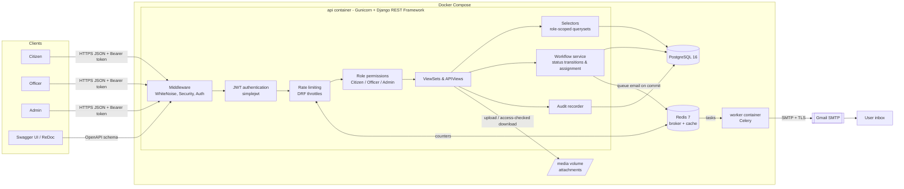
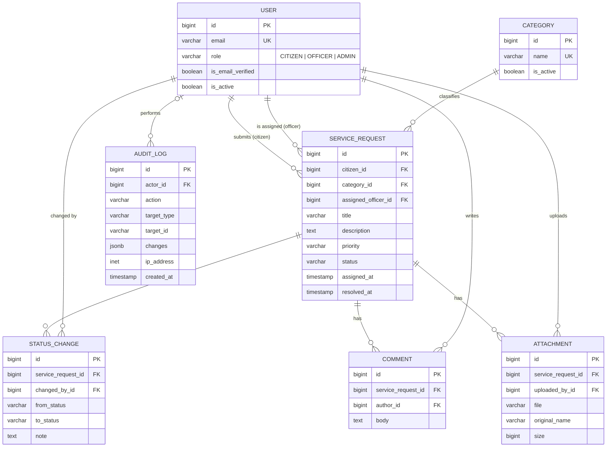
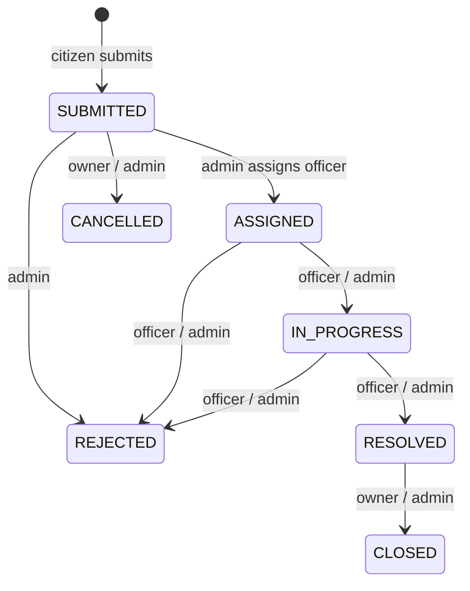

# Government Service Request Management System

A REST API backend where **citizens** submit service requests, **officers** process them, and
**admins** manage categories, users, assignments and statistics.

Built with Python 3.12, Django 5.2, Django REST Framework, PostgreSQL 16, JWT, Redis, Celery,
Docker and pytest.

---

## Contents

- [Features](#features)
- [Architecture](#architecture)
- [Entity Relationship Diagram](#entity-relationship-diagram)
- [Quick start (Docker)](#quick-start-docker)
- [Email setup (Gmail SMTP)](#email-setup-gmail-smtp)
- [Configuration](#configuration)
- [API documentation](#api-documentation)
- [Endpoints](#endpoints)
- [Roles and permissions](#roles-and-permissions)
- [Request status workflow](#request-status-workflow)
- [Audit logs](#audit-logs)
- [Rate limiting](#rate-limiting)
- [Running tests](#running-tests)
- [Project structure](#project-structure)
- [Git workflow](#git-workflow)
- [Design decisions](#design-decisions)

---

## Features

**Authentication**
- Register (always creates a Citizen) with **email verification** via signed, expiring links
- JWT login / refresh / logout (refresh tokens rotated and blacklisted)
- Roles: `CITIZEN`, `OFFICER`, `ADMIN`; role embedded as a JWT claim

**Service requests**
- Create / view / update requests with category, title, description and priority
- Strict status workflow with per-role transitions and full status history
- Officer assignment and reassignment
- Comments and file attachments (validated type & size, access-checked downloads)
- Filtering, search, ordering and pagination on the list endpoint

**Admin**
- Manage categories, create officers/admins, change roles, deactivate users
- Assign officers, view all requests
- Statistics: counts by status / priority / category, officer workload, average resolution time

**Bonus**
- **Redis + Celery**: background email delivery with retries, shared cache
- **Email notifications** on assignment, status changes and comments, plus **email verification**
- **Audit logs**: append-only record of logins, user/category/request changes, file access
- **Rate limiting**: global and per-endpoint throttles backed by Redis

---

## Architecture



More diagrams (request lifecycle sequence, state machine, code layout): [docs/architecture.md](docs/architecture.md).

---

## Entity Relationship Diagram



Full column list and notes: [docs/erd.md](docs/erd.md).

---

## Quick start (Docker)

Requirements: Docker with Docker Compose v2.

```bash
git clone <repo-url> service-management-system
cd service-management-system
cp .env.example .env            # then fill in the Gmail settings (see below)
docker compose up -d --build    # api, worker, db, redis; migrations run automatically
docker compose exec api python manage.py seed_demo   # optional demo data
```

- API: <http://localhost:8000/api/v1/>
- Docs: <http://localhost:8000/api/docs/>
- Health: <http://localhost:8000/api/v1/health/> (checks PostgreSQL and Redis)

### Demo accounts (created by `seed_demo`)

| Role | Email | Password |
|---|---|---|
| Admin | `admin@gsr.local` | `DemoPass123!` |
| Officer | `officer@gsr.local` | `DemoPass123!` |
| Citizen | `citizen@gsr.local` | `DemoPass123!` |

Demo accounts are pre-verified. `seed_demo` also creates five categories; it is idempotent, and
`--password` sets another password. To create your own first admin instead:
`docker compose exec api python manage.py createsuperuser` (superusers always get the `ADMIN` role).

### Try it with curl

```bash
# log in as the citizen and keep the access token
TOKEN=$(curl -s -X POST localhost:8000/api/v1/auth/login/ \
  -H 'Content-Type: application/json' \
  -d '{"email":"citizen@gsr.local","password":"DemoPass123!"}' | jq -r .access)

# submit a request
curl -X POST localhost:8000/api/v1/requests/ \
  -H "Authorization: Bearer $TOKEN" -H 'Content-Type: application/json' \
  -d '{"category":1,"title":"Leaking pipe","description":"Main pipe on Road 5","priority":"HIGH"}'
```

---

## Email setup (Gmail SMTP)

Emails (verification links and request notifications) are sent by the Celery **worker** through SMTP.

1. Turn on **2-Step Verification** for the Google account.
2. Create an **app password** at <https://myaccount.google.com/apppasswords>.
3. In `.env` set:

   ```dotenv
   EMAIL_HOST_USER=your-account@gmail.com
   EMAIL_HOST_PASSWORD=your-16-char-app-password
   DEFAULT_FROM_EMAIL=Service Desk <your-account@gmail.com>
   ```

   (`EMAIL_HOST=smtp.gmail.com`, `EMAIL_PORT=587`, `EMAIL_USE_TLS=1` are already in `.env.example`.)
4. `docker compose up -d` (restart the `worker` if it was already running).

`.env` is git-ignored, so credentials never go into the repository.

**No SMTP credentials?** Set `EMAIL_BACKEND=django.core.mail.backends.console.EmailBackend`; emails,
including verification links, are then printed in `docker compose logs worker`. You can also set
`EMAIL_VERIFICATION_REQUIRED=0` to allow login without verifying.

---

## Configuration

All settings come from environment variables (see [.env.example](.env.example)).

| Variable | Default | Description |
|---|---|---|
| `DJANGO_SECRET_KEY` | — (required) | Django secret key, also signs JWTs and verification links |
| `DJANGO_DEBUG` | `0` | Debug mode |
| `DJANGO_ALLOWED_HOSTS` | `localhost,127.0.0.1` | Comma-separated hosts |
| `DJANGO_TIME_ZONE` | `UTC` | Time zone |
| `API_PORT` | `8000` | Host port for the API container |
| `POSTGRES_DB` / `POSTGRES_USER` / `POSTGRES_PASSWORD` | `gsr` / `gsr` / — | Database credentials |
| `POSTGRES_HOST` / `POSTGRES_PORT` | `localhost` / `5432` | Set to `db` / `5432` by Compose |
| `REDIS_URL` | `redis://localhost:6379/0` | Celery broker, result backend and cache (Compose sets `redis://redis:6379/0`) |
| `JWT_ACCESS_TOKEN_MINUTES` | `30` | Access token lifetime |
| `JWT_REFRESH_TOKEN_DAYS` | `7` | Refresh token lifetime (rotated & blacklisted on use) |
| `ATTACHMENT_MAX_SIZE_MB` | `10` | Max upload size |
| `ATTACHMENT_ALLOWED_EXTENSIONS` | `pdf,jpg,jpeg,png,doc,docx,txt` | Allowed upload types |
| `EMAIL_BACKEND` | console backend | `…smtp.EmailBackend` for real delivery |
| `EMAIL_HOST` / `EMAIL_PORT` / `EMAIL_USE_TLS` | `localhost` / `25` / `0` | SMTP server (`.env.example`: Gmail) |
| `EMAIL_HOST_USER` / `EMAIL_HOST_PASSWORD` | empty | SMTP credentials (Gmail app password) |
| `EMAIL_TIMEOUT` | `15` | SMTP timeout in seconds |
| `DEFAULT_FROM_EMAIL` | `Service Desk <no-reply@gsr.local>` | Sender address |
| `EMAIL_VERIFICATION_REQUIRED` | `1` | Block login until the email is verified |
| `EMAIL_VERIFICATION_TOKEN_HOURS` | `24` | Verification link lifetime |
| `THROTTLE_ANON` / `THROTTLE_USER` | `60/minute` / `1000/hour` | Global limits |
| `THROTTLE_LOGIN` / `THROTTLE_REGISTER` | `5/minute` / `10/hour` | Auth limits per IP |
| `THROTTLE_EMAIL` / `THROTTLE_UPLOADS` | `5/hour` / `30/hour` | Resend-verification and upload limits |
| `NUM_PROXIES` | `0` | Trusted reverse proxies; `0` ignores `X-Forwarded-For` |

---

## API documentation

| URL | Description |
|---|---|
| `/api/docs/` | Swagger UI (use **Authorize** with `Bearer <access token>`) |
| `/api/redoc/` | ReDoc |
| `/api/schema/` | Raw OpenAPI 3 schema |

---

## Endpoints

All paths are prefixed with `/api/v1`.

| Method | Path | Who | Description |
|---|---|---|---|
| GET | `/health/` | public | Liveness + DB + Redis check |
| POST | `/auth/register/` | public | Register a citizen, sends a verification email |
| GET / POST | `/auth/verify-email/` | public | Verify with `?token=` (link) or `{"token": …}` |
| POST | `/auth/resend-verification/` | public | `{"email": …}` send a new link (same answer for any email) |
| POST | `/auth/login/` | public | Obtain access + refresh tokens (verified accounts only) |
| POST | `/auth/refresh/` | public | Rotate refresh token, new access token |
| POST | `/auth/logout/` | authenticated | Blacklist a refresh token |
| GET / PATCH | `/auth/me/` | authenticated | Own profile (name only editable) |
| GET / POST | `/users/` | admin | List (filter `role`, `is_active`; search) / create any role |
| GET / PATCH | `/users/{id}/` | admin | View / change role, activation, verification, password |
| GET | `/categories/` | authenticated | List (non-admins see active only) |
| POST / PATCH / DELETE | `/categories/{id}/` | admin | Manage categories (in-use ones return 409 on delete) |
| GET | `/requests/` | authenticated | Role-scoped list; filter `status`, `priority`, `category`, `assigned_officer`, `citizen`; `search`; `ordering` (`created_at`, `priority_rank`, …) |
| POST | `/requests/` | citizen | Submit a request |
| GET | `/requests/{id}/` | can view | Detail incl. `status_history` and `allowed_transitions` for the caller |
| PATCH | `/requests/{id}/` | owner (SUBMITTED) / admin (open) | Edit title, description, category, priority |
| POST | `/requests/{id}/status/` | per workflow | `{"status": "...", "note": "..."}` |
| POST | `/requests/{id}/assign/` | admin | `{"officer": <id>}` assign / reassign |
| GET / POST | `/requests/{id}/comments/` | can view | List / add comments |
| GET / POST | `/requests/{id}/attachments/` | can view | List / upload (`multipart/form-data`, field `file`) |
| GET | `/requests/{id}/attachments/{aid}/download/` | can view | Download a file |
| GET | `/admin/statistics/` | admin | Dashboard statistics |
| GET | `/admin/audit-logs/` | admin | Audit trail; filter `action`, `actor`, `target_type`, `target_id`, `created_after`, `created_before` |

---

## Roles and permissions

| Action | Citizen | Officer | Admin |
|---|:---:|:---:|:---:|
| Register publicly | ✅ (always Citizen) | — | — |
| Submit request | ✅ | ❌ | ❌ |
| See requests | own | assigned to them | all |
| Edit request details | own, while `SUBMITTED` | ❌ | while not closed/rejected/cancelled |
| Change status | cancel / close own | work on assigned | any allowed transition |
| Assign officer | ❌ | ❌ | ✅ |
| Comment / attach files | on visible requests | on visible requests | ✅ |
| Manage categories & users | ❌ | ❌ | ✅ |
| Statistics & audit logs | ❌ | ❌ | ✅ |

Requests a user cannot see return **404** (not 403) so their existence is not leaked.

---

## Request status workflow



- `SUBMITTED → ASSIGNED` only happens through `/assign/`. Reassigning keeps the current status.
- Moving to `REJECTED` requires a `note`.
- Each transition is stored in `status_history` with who, when and the note, and emails everyone
  involved except the person who made the change.
- The transition table lives in [`apps/service_requests/workflow.py`](apps/service_requests/workflow.py);
  transitions lock the row (`SELECT … FOR UPDATE`) to avoid concurrent double transitions.

---

## Audit logs

Every security-relevant or business action writes an append-only `AuditLog` row:
`LOGIN_SUCCEEDED`, `LOGIN_FAILED`, `USER_REGISTERED`, `EMAIL_VERIFIED`, `USER_CREATED`,
`USER_UPDATED`, `CATEGORY_CREATED/UPDATED/DELETED`, `REQUEST_CREATED`, `REQUEST_UPDATED`,
`REQUEST_STATUS_CHANGED`, `OFFICER_ASSIGNED`, `COMMENT_ADDED`, `ATTACHMENT_UPLOADED`,
`ATTACHMENT_DOWNLOADED`.

Each entry stores the actor, the target (`target_type` + `target_id`), a field-level diff in
`changes` (passwords are recorded only as `"changed"`) and the client IP. Rejected actions are not
logged as changes, and a delete that fails rolls back its audit entry. Entries cannot be edited
or deleted through the API or the Django admin.

---

## Rate limiting

DRF throttles with counters in Redis, so the limits hold across all Gunicorn workers:

| Scope | Default | Applies to |
|---|---|---|
| `anon` | 60/minute per IP | every unauthenticated request |
| `user` | 1000/hour per user | every authenticated request |
| `login` | 5/minute per IP | `/auth/login/` |
| `register` | 10/hour per IP | `/auth/register/` |
| `email` | 5/hour per IP | `/auth/resend-verification/` |
| `uploads` | 30/hour per user | `POST /requests/{id}/attachments/` |

Exceeding a limit returns **429** with a `Retry-After` header. The client IP is `REMOTE_ADDR`
unless `NUM_PROXIES` is set, so a forged `X-Forwarded-For` header can't be used to get around the limits.

---

## Running tests

Tests live in [`tests/`](tests/) and run with pytest-django against PostgreSQL. Redis and SMTP are
not needed: tests use an in-memory cache, run Celery tasks inline and capture email in memory.

```bash
# inside Docker (recommended)
docker compose exec api pytest

# or locally (needs a reachable PostgreSQL; the user must be allowed to create the test DB)
python -m venv .venv && . .venv/bin/activate
pip install -r requirements.txt
export DJANGO_SECRET_KEY=dev-secret POSTGRES_PASSWORD=gsr POSTGRES_HOST=localhost
pytest
```

---

## Project structure

```
.
├── apps/
│   ├── accounts/          # user model, roles, JWT auth, email verification, user management, seed_demo
│   ├── audit/             # audit log model, recorder, admin endpoint
│   ├── categories/        # service categories
│   ├── common/            # base model, health check
│   ├── notifications/     # celery email task
│   └── service_requests/  # requests, workflow, comments, attachments, notifications, statistics
├── config/                # settings, urls, celery, wsgi/asgi
├── docker/entrypoint.sh   # migrate + collectstatic, then exec the command
├── docs/                  # architecture diagrams and ERD
├── tests/                 # pytest suite
├── Dockerfile
├── docker-compose.yml     # api, worker, db (PostgreSQL), redis
├── .env.example
└── requirements.txt
```

---

## Git workflow

- **Long-lived branches:** `main` (released, stable) and `develop` (integration).
- **Feature branches:** `feature/<name>` branched from `develop`, built with incremental commits,
  merged back into `develop` with `--no-ff` so every feature remains visible as a unit.
  Feature branches are **kept** after merging.
- **Releases:** `develop` is merged into `main` with `--no-ff` and tagged (`v0.1.0` core, `v1.0.0` with bonus features).
- **Commit messages:** Conventional Commits, `<type>(<scope>): <description>` with
  `feat`, `fix`, `refactor`, `test`, `docs`, `chore`, `build`.

```bash
git log --oneline --graph --all   # see the full branch history
```

---

## Design decisions

- **Email is the login identifier**, stored lower-cased so login is case-insensitive.
- **Registration never lets the caller pick a role.** Officers and admins are created by an admin
  (`POST /users/`, pre-verified) or via `createsuperuser` / `seed_demo`.
- **Verification without a table.** Links carry a signed, expiring token bound to the user's id and
  email; the "not verified" error is only shown after the password matched, so it doesn't reveal
  which emails are registered. Resend always gives the same answer for the same reason.
- **Emails never block requests.** They are queued on transaction commit and sent by Celery with retries.
- **Nothing important is hard-deleted.** Users and categories are deactivated; requests are closed,
  rejected or cancelled. Comments and attachments are immutable to preserve the record.
- **Attachments are private.** Files are stored under random names and are only downloadable
  through an endpoint that applies the same visibility rules as the request.
- **Access tokens carry the role** as a claim for client convenience; the server always re-reads
  the role from the database for authorization.
