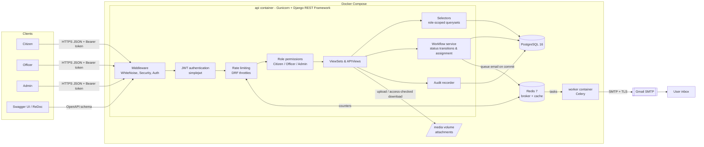
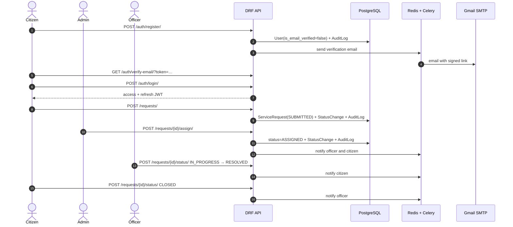
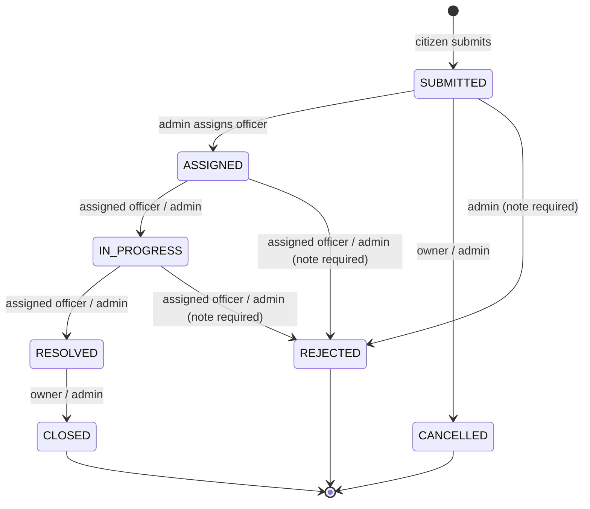

# Architecture

## System overview

- **api** serves HTTP. Every request passes authentication, throttling and role permissions.
- **worker** runs Celery tasks (email delivery, retried with backoff on SMTP errors), so a slow
  mail server never slows down an API response.
- **Redis** is the Celery broker/result backend and the Django cache that holds throttle counters,
  shared by all Gunicorn workers.
- Emails are queued with `transaction.on_commit`, so nothing is sent for work that rolled back.

## Request lifecycle

## Status workflow

## Code layout

| Layer | Location | Responsibility |
|---|---|---|
| Settings / routing | `config/` | Env-driven settings, URL routing, OpenAPI, Celery app |
| Accounts | `apps/accounts/` | User model with roles, JWT auth, email verification, admin user management, `seed_demo` |
| Categories | `apps/categories/` | Service categories (admin-managed) |
| Service requests | `apps/service_requests/` | Requests, status history, comments, attachments, statistics |
| ↳ `selectors.py` | | Which requests a user may see (role scoping) |
| ↳ `workflow.py` | | Status transition table, officer assignment, row locking |
| ↳ `notifications.py` | | Who gets emailed about which request event |
| ↳ `statistics.py` | | Aggregations for the admin dashboard |
| Notifications | `apps/notifications/` | Celery `send_email` task, on-commit queueing |
| Audit | `apps/audit/` | Append-only `AuditLog`, recording helper, admin endpoint |
| Common | `apps/common/` | Shared base model, health check (DB + Redis) |
| Tests | `tests/` | pytest-django API tests against PostgreSQL |
