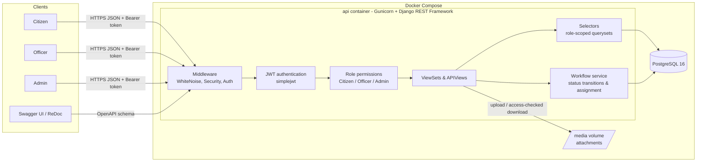
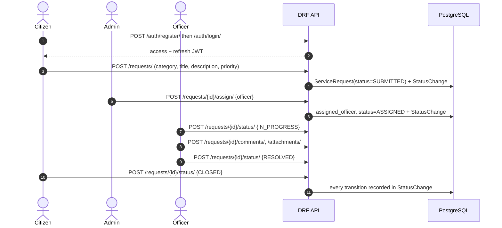
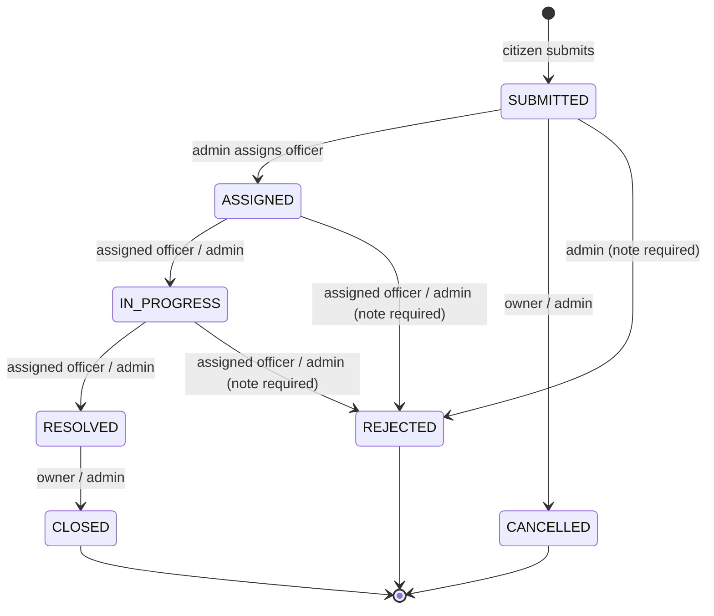

# Architecture

## System overview

## Request lifecycle

## Status workflow

## Code layout

| Layer | Location | Responsibility |
|---|---|---|
| Settings / routing | `config/` | Env-driven settings, URL routing, OpenAPI |
| Accounts | `apps/accounts/` | User model with roles, JWT auth, admin user management, `seed_demo` |
| Categories | `apps/categories/` | Service categories (admin-managed) |
| Service requests | `apps/service_requests/` | Requests, status history, comments, attachments, statistics |
| ↳ `selectors.py` | | Which requests a user may see (role scoping) |
| ↳ `workflow.py` | | Status transition table, officer assignment, row locking |
| ↳ `statistics.py` | | Aggregations for the admin dashboard |
| Common | `apps/common/` | Shared base model, health check |
| Tests | `tests/` | pytest-django API tests against PostgreSQL |
