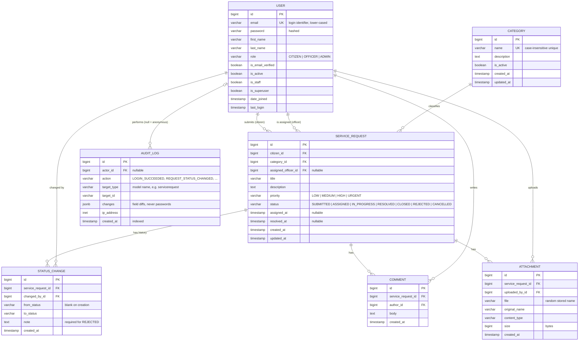

# Entity Relationship Diagram

## Notes

- **Deletion policy**: users, categories in use and requests are never hard-deleted (`PROTECT` foreign keys).
  Users are deactivated; categories are deactivated; requests end in `CLOSED`, `REJECTED` or `CANCELLED`.
- **Indexes**: `service_request.status` and `service_request.priority` are indexed for list filtering and statistics;
  `audit_log` is indexed on `created_at`, `action` and `(target_type, target_id)`.
- **Audit log** is a generic log: `target_type` + `target_id` point at any row (user, category,
  service request) without a hard foreign key, so entries survive and stay immutable.
- **Email verification** needs no table: tokens are signed (`django.core.signing`) and time-limited.
- JWT refresh-token blacklisting uses the `token_blacklist` tables provided by `djangorestframework-simplejwt`
  (`OutstandingToken`, `BlacklistedToken`), omitted above for clarity.
